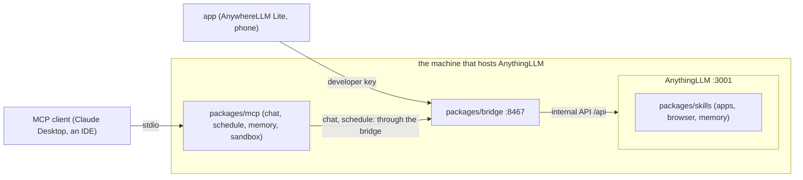

# Architecture

To fill in when the parts are moved in: how a request passes `BRIDGE_ALLOW`, and which part owns each secret (the AnythingLLM password stays with the bridge; the MCP servers and the app hold only developer keys).
